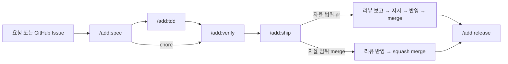

# add-project

ADD(Agent Driven Development) 프로젝트 틀과 절차 스킬을 담은 Claude Code 플러그인.

- 사람: 요구사항, 결정, 리뷰
- agent: 스펙, 테스트, 구현, 검증, PR, 릴리스
- 장치: 스펙 주도 TDD, 로컬과 CI 가 같은 단일 검증 명령, 프로젝트별 성숙도·자율 범위

적용 예: [hwanyu365/argos](https://github.com/hwanyu365/argos) (Android + Firebase, v1.0.0)
참고한 방법론과 채택 이유: [docs/benchmark.md](docs/benchmark.md)

## 설치

private 저장소라 git 이 묻지 않고 인증할 수 있어야 한다 (Claude Code 는 git 을 비대화식으로 실행한다).

- HTTPS: `gh auth login` → `gh auth setup-git` 으로 credential helper 에 저장
- GitHub SSH 키가 없으면 `CLAUDE_CODE_PLUGIN_PREFER_HTTPS=1` 을 설정한다 → 세션 안의 `/plugin` 설치와 `plugin update` 는 HTTPS 로 다시 시도하지 않는다

```sh
claude plugin marketplace add hwanyu365/add-project
claude plugin install add@add-project
```

- 갱신: `claude plugin marketplace update add-project` → `claude plugin update add@add-project` (자동 갱신은 기본으로 꺼져 있다)
- 플러그인 hook: 세션 시작 시 main 클론의 `.add/handoff.md` 를 컨텍스트에 넣는다
- Claude Code v2.1.295 이상: 템플릿의 차단 hook 은 `onFailure: "block"` 으로 hook 실패·시간 초과도 막는다. 그보다 낮은 버전은 이 필드를 모르므로 실패가 통과로 끝난다
- [MountainUnicorn/add](https://github.com/MountainUnicorn/add) 와 함께 설치하면 `/add:*` 명령 이름이 겹친다. 하나만 설치한다.

## 사용 흐름



| 명령 | 하는 일 |
| --- | --- |
| `/add:init` | 현재 저장소에 틀을 복사하고 자리표시자(스택, 검증 명령, 성숙도, 자율 범위, 리뷰 방식 등)를 인터뷰로 채움 |
| `/add:spec [이슈]` | 워크트리·브랜치 생성 → `docs/spec_{function}.md` 갱신, 요구사항 ID·TC 부여, `[확인필요]` 0건. 이슈가 없으면 확인받고 생성 |
| `/add:tdd` | TC 로 테스트 먼저(Red) → 최소 구현(Green) → 정리 |
| `/add:verify` | 검증 명령 + 스펙 항목별 구현 위치·TC 대조(대화 이력 없는 subagent) + 변경 범위 점검. chore 는 대조 생략 |
| `/add:ship` | 커밋 → draft PR → CI·리뷰 조사 → 후속 건 이슈 등록(`pr` 은 후보 보고) → 자율 범위에 따라 보고 또는 merge |
| `/add:release <버전>` | 태그 → 릴리스 워크플로 확인 → 배포 후 확인 목록 |
| `/add:handoff` | main 클론의 `.add/handoff.md` 에 현재 상태 기록 |

## 프로젝트에 생기는 것

| 경로 | 역할 |
| --- | --- |
| `CLAUDE.md` | 규칙 원본: 원칙, 절차, 검증 명령, 성숙도, 자율 범위, GIT, 문서·주석 |
| `docs/specification.md` | 색인 + 공통 제약 |
| `docs/spec_{function}.md` | 기능별 스펙 (§1~§7) |
| `docs/rules_spec.md` | 스펙 작성 규칙 |
| `.claude/settings.json` | 자율 범위 `pr` 에 필요한 권한, 비밀 파일 Read 거부, 커밋 직전 hook (비밀 파일, 검증 뒤 변경), merge 게이트 hook. hook 이 실패해도 막음 |
| `.claude/hooks/merge-gate.sh` | `gh pr merge` 직전에 CI 통과, 현재 head 의 리뷰 요약(작성자 확인), Blocking 0건, `--match-head-commit` 을 확인하고 아니면 막음 |
| `.claude/hooks/verify.sh` | 추적성 검사 + 검증 명령. 통과한 작업 트리를 기록하고, 커밋 직전에 달라졌으면 막음 |
| `.github/workflows/ci.yml` | 비밀 파일 가드 + 추적성 검사 + 검증 명령 |
| `.github/spec-trace.sh` | 스펙 ↔ TC ↔ 테스트 이름 대조 (누락, 고아 TC, `[확인필요]`, 형식 위반, 테스트 삭제 경고). 성숙도 `poc` 는 보고만 |
| `.github/secret-files.regex` | 커밋되면 안 되는 파일 목록. CI 가드와 `.claude/settings.json` 의 커밋 직전 hook 이 함께 읽음 |
| `.github/workflows/claude.yml` | 이슈·PR 의 `@claude` (소유자·협업자만, 리뷰·질의응답 전용으로 커밋·push 차단). 리뷰 `github` 일 때만 |
| `.github/workflows/claude-review.yml` | PR 자동 리뷰 (같은 저장소 브랜치만, 양식 고정). 리뷰 `github` 일 때만. `local` 이면 `/add:ship` 이 로컬 subagent 로 리뷰 |
| `.github/workflows/release.yml` | `v*` 태그 → 검증 → 산출물 → GitHub Release |
| `.github/ISSUE_TEMPLATE/`, `pull_request_template.md` | 스토리·인수 조건, 재현 절차, chore, PR 검증 항목 |

### 자율 범위

| 값 | agent 가 묻지 않고 하는 일 |
| --- | --- |
| `pr` (기본) | draft PR, CI, 리뷰 조사·보고까지. 반영·merge 는 지시 후 |
| `merge` | 리뷰 반영·squash merge 까지 |

어느 쪽이든 스펙에 없는 결정, 비용, 클라우드·Secrets, 운영 데이터, 자율 범위·성숙도의 변경은 먼저 묻는다.

## 저장소 구조

```
.claude-plugin/marketplace.json   # 마켓플레이스 → plugins/add
plugins/add/
  .claude-plugin/plugin.json
  skills/<명령>/SKILL.md
  hooks/hooks.json                # 세션 시작 시 handoff 주입
  template/                       # /add:init 이 복사하는 프로젝트 틀
docs/benchmark.md
```
