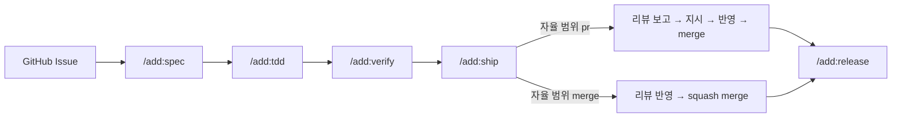

# add-project

ADD(Agent Driven Development) 프로젝트 틀과 절차 스킬을 담은 Claude Code 플러그인.

- 사람: 요구사항, 결정, 리뷰
- agent: 스펙, 테스트, 구현, 검증, PR, 릴리스
- 장치: 스펙 주도 TDD, 로컬과 CI 가 같은 단일 검증 명령, 프로젝트별 성숙도·자율 범위

적용 예: [hwanyu365/argos](https://github.com/hwanyu365/argos) (Android + Firebase, v1.0.0)
참고한 방법론과 채택 이유: [docs/benchmark.md](docs/benchmark.md)

## 설치

private 저장소라 `gh auth login` 으로 GitHub 인증이 되어 있어야 한다.

```sh
claude plugin marketplace add hwanyu365/add-project
claude plugin install add@add-project
```

- 갱신: `claude plugin marketplace update add-project` → `claude plugin update add@add-project`
- [MountainUnicorn/add](https://github.com/MountainUnicorn/add) 와 함께 설치하면 `/add:*` 명령 이름이 겹친다. 하나만 설치한다.

## 사용 흐름



| 명령 | 하는 일 |
| --- | --- |
| `/add:init` | 현재 저장소에 틀을 복사하고 자리표시자(스택, 검증 명령, 성숙도, 자율 범위 등)를 인터뷰로 채움 |
| `/add:spec <이슈>` | 이슈 → `docs/spec_{function}.md` 갱신, 요구사항 ID·TC 부여, `[확인필요]` 0건 |
| `/add:tdd` | TC 로 테스트 먼저(Red) → 최소 구현(Green) → 정리 |
| `/add:verify` | 검증 명령 + 스펙 항목별 구현 위치·TC 대조 + 변경 범위 점검 |
| `/add:ship` | 커밋 → draft PR → CI·리뷰 조사 → 자율 범위에 따라 보고 또는 merge |
| `/add:release <버전>` | 태그 → 릴리스 워크플로 확인 → 배포 후 확인 목록 |
| `/add:handoff` | `.add/handoff.md` 에 현재 상태 기록 |

## 프로젝트에 생기는 것

| 경로 | 역할 |
| --- | --- |
| `CLAUDE.md` | 규칙 원본: 원칙, 절차, 검증 명령, 성숙도, 자율 범위, GIT, 문서·주석 |
| `docs/specification.md` | 색인 + 공통 제약 |
| `docs/spec_{function}.md` | 기능별 스펙 (§1~§7) |
| `docs/rules_spec.md` | 스펙 작성 규칙 |
| `.github/workflows/ci.yml` | 비밀 파일 가드 + 검증 명령 |
| `.github/workflows/claude.yml` | 이슈·PR 의 `@claude` (소유자·협업자만) |
| `.github/workflows/claude-review.yml` | PR 자동 리뷰 (같은 저장소 브랜치만, 양식 고정) |
| `.github/workflows/release.yml` | `v*` 태그 → 검증 → 산출물 → GitHub Release |
| `.github/ISSUE_TEMPLATE/`, `pull_request_template.md` | 스토리·인수 조건, 재현 절차, PR 검증 항목 |

### 자율 범위

| 값 | agent 가 묻지 않고 하는 일 |
| --- | --- |
| `pr` (기본) | draft PR, CI, 리뷰 조사·보고까지. 반영·merge 는 지시 후 |
| `merge` | 리뷰 반영·squash merge 까지 |

어느 쪽이든 스펙에 없는 결정, 비용, 클라우드·Secrets, 운영 데이터, 자율 범위 자체의 변경은 먼저 묻는다.

## 저장소 구조

```
.claude-plugin/marketplace.json   # 마켓플레이스 → plugins/add
plugins/add/
  .claude-plugin/plugin.json
  skills/<명령>/SKILL.md
  template/                       # /add:init 이 복사하는 프로젝트 틀
docs/benchmark.md
```
