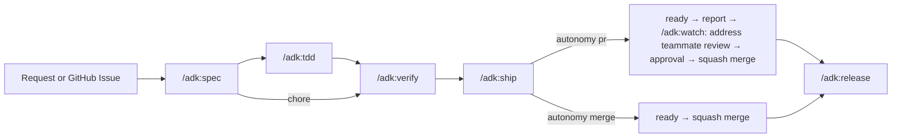

# agentic-dev-kit

A project scaffold and procedure skills that make Claude Code agents develop with SDD (Spec-Driven Development) + TDD.
Steps the agent must not skip (a single verification command with a spec ↔ TC ↔ test traceability check inside it, read-only review, merge gate) are enforced with hooks and CI. The strictness is tuned per project maturity.

- Human: requirements, decisions, review
- Agent: spec, tests, implementation, verification, PR, release
- Mechanisms: spec-driven TDD, the same single verification command locally and in CI, per-project maturity and autonomy scope

Example adoption: [hwanyu365/argos](https://github.com/hwanyu365/argos) (Android + Firebase, v1.0.0)
Methodologies referenced and why they were adopted: [docs/benchmark.md](docs/benchmark.md)

## Installation

- If you don't have a GitHub SSH key, set `CLAUDE_CODE_PLUGIN_PREFER_HTTPS=1` → `/plugin` installs inside a session and `plugin update` do not retry over HTTPS

```sh
claude plugin marketplace add hwanyu365/agentic-dev-kit
claude plugin install adk@agentic-dev-kit
```

- The plugin name is `adk` and its commands are `/adk:*`
- Update: `claude plugin marketplace update agentic-dev-kit` → `claude plugin update adk@agentic-dev-kit` (auto-update is off by default)
  - Updating only the plugin leaves the scaffold (hooks, CI, CLAUDE.md) in already-adopted repositories unchanged → align it with `/adk:init --update` in that repository
- Plugin hooks: on session start, inject the main clone's `.adk/handoff.md` into context; restrict the Bash of the two agents below to query commands; check the return format of `adk:reviewer`; and on context compaction, keep progress state (issues, review items, owner decisions) in the summary
- Plugin agents: `adk:reviewer` (local review), `adk:spec-verifier` (spec cross-check)
  - They have no editing tools (Edit, Write), and their Bash is restricted to an allowlist by a hook: only git/gh queries, read tools, and the repository's self-checks and verification wrapper pass
  - Decisions are made on the words the shell actually passes (with quotes and backslashes resolved). Commands outside the list, expansions (`$`, braces, globs), substitutions, parentheses, file redirection and shell wrapping are all blocked
  - File-writing and command-execution options of allowed commands are blocked by name prefix (git `--out*`, `--ext*`, `--op*`, `--upl*`, `--exec*`, `git grep -O`, `gh api` write flags, URLs and `--hostname`, gh `--web`, gh URL arguments, `-R`/`--repo` only as OWNER/REPO regardless of position (`R` inside a short-option bundle is blocked), `repo view` arguments only allowed characters with a single `/`, `git fetch` only a remote name and refs without `:` or `+`). This list covers what was checked against each command's option docs → re-check when adding allowed commands or when a tool adds options
  - Shell builtins that re-expand arguments (`printf -v`, `test -v`) are not on the list
  - Remaining local writes: `git fetch`'s FETCH_HEAD, remote-tracking refs and objects (with the default refspec; in repositories where `remote.*.fetch` targets local branches, local refs change too), and the index refresh by `git status` and `git describe --dirty`
  - The self-checks (`sh tests/*.test.sh`) and the verification wrapper (`sh .claude/hooks/verify.sh`) run repository code as-is → what that code does is outside the hook's restriction, and those of another repository moved into with `cd` also run. For this scope the agent instructions are the reference
  - Commands run by the git config of a repository moved into with `cd` or `git -C` (`core.fsmonitor`, external diff, etc.) are also outside the hook's scope → for the same reason the agent instructions are the reference
- Claude Code v2.1.295 or later: the template's blocking hooks use `onFailure: "block"` so hook failures and timeouts also block. Older versions don't know this field, so failures end up passing

## Workflow



| Command | What it does |
| --- | --- |
| `/adk:init` | Copies the scaffold into the current repository and fills placeholders (stack, verification command, maturity, autonomy scope, review mode, up-to-date branch requirement, etc.) through an interview. `--update` reads the current values of an adopted repository and compares/merges each file with the latest template |
| `/adk:spec [issue]` | Creates worktree and branch, verifies the baseline → updates `docs/spec_{function}.md`, assigns requirement IDs and TCs, zero `[확인필요]` (needs confirmation) markers. Creates an issue after confirmation if none exists |
| `/adk:tdd` | Tests first from TCs (Red) → minimal implementation (Green) → refactor. Stops after 3 failed attempts at the same TC. For review comments, exhaustively counts every place the same input arrives and starts with tests |
| `/adk:verify` | Verification command + per-spec-item cross-check of implementation location, TC and Then assertions, plus diff → spec reverse check (subagent without conversation history) + security boundary mutation table + comparison of blocking mechanisms with the previous version + change scope check. Cross-checks are skipped for chores |
| `/adk:ship` | Commit (local review before push when review is `local`) → draft PR → investigate and address CI and reviews → file follow-up issues → turn repeated comments into rule-making issues → stop decision (up to 2 re-review rounds for B and S; mergeable when only Nits remain) → ready → with autonomy `pr`, confirm review requests and report; with `merge`, squash merge |
| `/adk:watch <PR>` | Watches a ready PR under autonomy `pr`; on start, first handles reviews and comments posted since the last review response comment → investigates and addresses teammate reviews (amend, push) → replies to and resolves threads → requests re-review → squash merge after approval of the current head. Stops and reports on comments that call for PRD or spec changes |
| `/adk:deps [PR]` | Checks Dependabot PR eligibility (author, signature, patch/minor; if off, `@dependabot recreate` or `rebase`) → CI → local subagent review → summary comment → with autonomy `merge`, squash merge when Blocking and Should Fix are 0; with `pr`, report. Majors are reported after review |
| `/adk:release <version>` | Checks TCs without automated tests → tag → checks the release workflow → post-release checklist |
| `/adk:handoff` | Records current state in the main clone's `.adk/handoff.md` |

## What gets added to a project

| Path | Role |
| --- | --- |
| `CLAUDE.md` | Source of rules: principles, procedures, verification command, maturity, autonomy scope, GIT, docs and comments |
| `docs/specification.md` | Index + common constraints |
| `docs/spec_{function}.md` | Per-feature spec (§1–§7) |
| `docs/rules_spec.md` | Spec writing rules |
| `.claude/settings.json` | Permissions needed for autonomy `pr`, deny Read of secret files, deny commands that skip pre-commit, set the git hook path on session start (the session continues even if it fails), check the hook path right before commit commands, and the commit/merge gate hook right before every Bash command. PreToolUse hooks block even when they fail. Not applied to sessions opened outside the repository root. allow applies only to paths where workspace trust was accepted |
| `.githooks/pre-commit` | Checks the working tree git is committing for secret files and post-verification changes, and blocks the commit otherwise. The hook path is set by `hooks-path.sh` |
| `.claude/hooks/hooks-path.sh` | Sets the git hook path to `.githooks`. Fails without changing anything if an existing `.git/hooks` is present or a different path is set. Called by the session start hook and `verify.sh`; `--check` is called by the hook right before commit commands |
| `.claude/hooks/commit-gate.sh` | Right before every Bash command, parses the options of `git … commit` and blocks, regardless of value: forms that disable pre-commit (`-n` inside a short-option bundle, abbreviations of `--no-verify`); commands that change `core.hooksPath`, `help.autocorrect`, `alias.*`, `include.*` or `includeIf.*` via `-c`, `--config-env` or `git config`; `GIT_CONFIG*` environment variables; and commits with `--git-dir`, `--work-tree`, `GIT_DIR`, `GIT_WORK_TREE` or `GIT_COMMON_DIR` (case-insensitive; `git config` reads and unsets are blocked too). Unknown git global options are blocked if followed by `commit`, `config`, `-c` or `--config-env`; after stripping wrapping commands (`env`, `time`, `exec`, `sudo`, `xargs`, etc.), a non-git command is blocked if `git` appears among the remaining words; `env -S` and `--split-string` are blocked regardless of content. Value positions and paths after `--` are not treated as options. `(`, `{`, `}`, `!` outside the command position and `<(…)`, `>(…)` do not split commands; words determined at run time (variables, substitutions, globs, braces) are blocked anywhere before `--` when unquoted, and in option positions when quoted. Expansions in the command name position are blocked if followed by `commit` or `config`; expansions in git global option or subcommand positions are blocked when unquoted, and when quoted the following words are judged as commit arguments |
| `.claude/hooks/merge-gate.sh` | Right before `gh pr merge`, checks CI passed, a review summary for the current head (author verified), 0 Blocking items and `--match-head-commit`, and blocks otherwise. For Dependabot PRs it also accepts a summary from the session account, but checks that every commit is authored by Dependabot and signed by GitHub (`web-flow`) and is patch/minor. Only allowlisted flags are accepted and `--squash` is required (`--admin`, `--auto`, etc. are blocked); unquoted expansions in arguments and merges after `export`ing expanded words are also blocked. For gh, if the text merge appears it must be an allowed subcommand; other commands (except allowed commands such as `git` and `echo`) are blocked if the word `merge` or `gh…merge` appears |
| `.claude/hooks/segments.awk`, `hook-lib.sh` | Command parsing used by the commit and merge gates. Treats quoted, heredoc and here-string bodies as data, removes redirection fd numbers and target words from arguments, reads the inside of `$(...)`, `` `...` `` and subshells as commands, and strips shell reserved words and wrappers like env and timeout |
| `.claude/hooks/verify.sh` | Traceability check + verification command. Records the working tree that passed, and blocks at commit time (pre-commit) if it has changed. Fails if the git hook path is not set correctly |
| `.github/workflows/ci.yml` | Secret file guard + traceability check + verification command |
| `.github/spec-trace.sh` | Cross-checks spec ↔ TC ↔ test names (the string `TC#n`, the identifier `tc{n}` on definition lines; missing items, orphan TCs, `[확인필요]`, format violations, test deletion warnings). Report-only at maturity `poc` |
| `.github/secret-files.regex` | List of files that must not be committed. Read by both the CI guard and `.githooks/pre-commit` |
| `.github/workflows/claude.yml` | `@claude` in issues and PRs (owners and collaborators only; review and Q&A only, commits and pushes blocked). Only when review is `github` |
| `.github/workflows/claude-review.yml` | Automatic PR review (same-repository branches only, fixed format). Only when review is `github`. When `local`, `/adk:ship` reviews with a local subagent |
| Common to both workflows | Reduces paths by which prompt injection in comments or PR bodies could read and post runner secrets: blocks file tool reads outside the repository (`blockReadsOutsideWorkingDirectories`), removes credentials from subprocess environments (`CLAUDE_CODE_SUBPROCESS_ENV_SCRUB`), and sets the permission mode explicitly (review `default`, `@claude` `acceptEdits`) to deny tool calls outside the allowlist → the action's default auto mode would pass those calls to a safety review. Remaining paths: the GitHub App token (used by `gh` and also embedded in the origin URL in `.git/config`), and subprocesses reading the parent process's `/proc/<pid>/environ` (no PID isolation) |
| `.github/workflows/release.yml` | `v*` tag → verification → artifacts → GitHub Release |
| `.github/ISSUE_TEMPLATE/`, `pull_request_template.md` | Stories and acceptance criteria, reproduction steps, chore, PR verification items |

### Autonomy scope

| Value | What the agent does without asking |
| --- | --- |
| `pr` (default) | Repositories with teammate review. Addresses reviews and CI up to ready. Responding to teammate reviews and merging happen after running `/adk:watch` |
| `merge` | Repositories without teammate review. Up to addressing reviews and squash merge |

Either way, decisions not in the spec, costs, cloud and Secrets, production data, and changes to autonomy scope or maturity are asked first.

## Repository structure

```
.claude-plugin/marketplace.json   # marketplace → plugins/adk
plugins/adk/
  .claude-plugin/plugin.json
  skills/<command>/SKILL.md
  agents/                         # read-only review and spec cross-check agents
  hooks/                          # handoff injection, blocking remote writes by read-only agents, review format check, items kept on compaction
  template/                       # project scaffold copied by /adk:init
docs/benchmark.md
```
