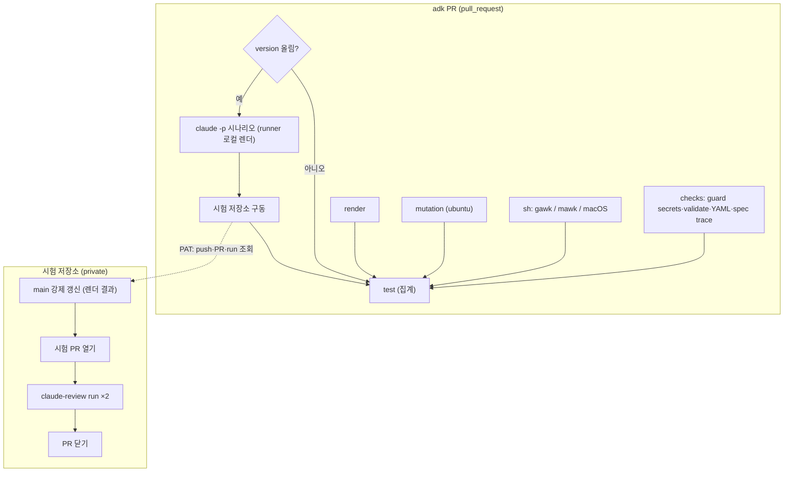

# agentic-dev-kit — 배포 전 검증 (release gate)

## 1. 개요

- 문서 정보: 작성 2026-11-13 / 기준 커밋 `7e10431` (origin/main) / 이슈 GH#17, GH#61, GH#63, GH#68, GH#70
- 기능: adk 변경을 adk 저장소 안에서 검증한 뒤에만 배포한다
- 목적 (Why)
  - 배포 = `plugins/adk/.claude-plugin/plugin.json` 의 `version` 을 올린 커밋이 main 에 들어가는 것 → 사용자 `plugin update` 대상이 된다.
  - 지금 merge 전 검증은 ubuntu 한 곳의 `tests/*.test.sh`·`plugin validate`·템플릿 YAML 파싱뿐이다.
  - 결함이 난 자리(OS·awk 차이, 보안 경계 조건, init 렌더 결과, 세션 시작 hook, 리뷰 워크플로 런타임)는 adk 에서 돌려볼 수단이 없다 → 적용 저장소가 결함을 찾고 수정본 확인까지 떠안았다.

## 2. 목표 및 범위

- In Scope
  - PR CI: OS·awk matrix, 보안 경계 mutation, init 렌더 검사
  - version 을 올린 PR 에만 도는 런타임 관문: adk 소유 private 시험 저장소에서 Claude Code 를 띄워 확인
  - adk `CLAUDE.md` 규칙: 검증 원칙과 version 기준
- Out of Scope
  - GH#16 수정 자체 → 이 관문을 거쳐 나간다
  - GH#3 남은 항목(하위 셸 토큰 부재, 원래 대상 파일) → 저장소 소유자 결정으로 private 저장소 세션이 확인
  - 템플릿이 적용 저장소에 만드는 CI(`ci.yml` 등)의 변경 → adk 자체 CI 만 다룬다

## 3. 요구사항

- `US#1` [요구사항] 저장소 소유자로서, 적용 저장소가 adk 결함을 찾지 않도록, adk 가 검증을 끝낸 변경만 배포되기를 원한다. → FR#1~FR#8
- `FR#1` [요구사항] PR·main push 마다 `tests/*.test.sh` 를 세 환경에서 돌린다: ubuntu gawk, ubuntu mawk(PATH 앞 `awk -> mawk`), macOS `/usr/bin/awk`.
  - 각 환경은 실제로 쓴 `awk` 를 로그에 남기고, 기대한 구현이 아니면 실패한다 → 공허한 통과 방지
- `FR#2` [요구사항] 보안 경계 조건마다 그 조건을 지운 사본에서 지정한 테스트가 실패해야 한다.
  - 목록 파일 한 행 = 대상 파일 / 지우는 방법 / 실패해야 할 테스트
  - 지우는 방법이 대상에 적용되지 않으면(원본과 같으면) 실패 → 코드가 바뀌어 mutation 이 공허해진 것을 드러낸다
  - 지운 사본에서 테스트가 통과하면 실패
  - 지워도 바로 뒤 검사가 같은 종료 코드로 막는 조건(동등 mutation)은 목록에서 빼고 이유를 목록 머리에 적는다
- `FR#3` [요구사항] 템플릿을 고정 값으로 렌더한 빈 저장소를 만들고 검사한다.
  - 치환되지 않은 `{{NAME}}` 0건 (`${{ }}` 제외)
  - 템플릿에 있는 자리표시자 집합 = `plugins/adk/skills/init/SKILL.md` 자리표시자 표의 집합 (양방향 차집합 0)
  - 렌더된 YAML 파싱, JSON 파싱, 셸 스크립트 `sh -n`
  - 렌더된 저장소에서 `verify.sh` 통과, 워크트리에서 커밋 시 pre-commit 이 그 워크트리 기준으로 판정
- `FR#4` [요구사항] PR 이 `version` 을 올리면 런타임 관문(FR#5)이 돌고, 그 결론이 adk PR 의 check 가 된다.
  - version 을 올리지 않은 PR 은 런타임 관문을 돌리지 않고 통과한다 (사유를 notice 로 남김)
  - 실행에 필요한 secret 이 없거나, 시험 저장소의 리뷰 run 을 찾지 못하거나, 시간 초과면 실패한다
- `FR#5` [요구사항] 런타임 관문은 adk PR head 의 템플릿을 렌더해 아래를 확인한다.
  - `claude -p` 세션 시작 후 새 클론의 `core.hooksPath` = `.githooks`
  - `claude -p --permission-mode bypassPermissions` 에서도 deny 규칙 명령(`git commit --no-verify`)을 실행하지 못함. 대조군으로 같은 모드의 일반 커밋은 실행됨
    - 프로젝트 allow 는 workspace trust 를 수락한 경로에만 적용된다 [as-built] (runtime 의 trust 전후 비교, Claude Code 2.1.319) → trust 기록 전의 기본 모드로는 대조군이 성립하지 않는다
  - 기본 모드: trust 전에는 허용 규칙의 커밋도 승인 대기, runner `~/.claude.json` 에 trust 를 기록한 뒤에는 실행됨 (GH#19)
  - 리뷰 job 의 격리: 렌더한 `claude-review.yml` 과 같은 격리 설정·권한 모드에 프롬프트·허용 도구(`Bash(sh probe/env.sh)`)만 바꾼 워크플로가 첫 head 에서 돈다 (`tests/probe.py`)
    - scrub 변형: 하위 셸에 action 의 워크플로 토큰(`DEFAULT_WORKFLOW_TOKEN`) 없음, Read 의 `/proc/self/environ`·`~/.claude/settings.json` 거부
    - 대조군(scrub 만 뺌): 워크플로 토큰 있음 → scrub 변형의 "없음" 이 원래 오지 않는 변수라서가 아님을 보인다
    - `CLAUDE_CODE_OAUTH_TOKEN` 은 scrub 과 관계없이 하위 셸에 오지 않는다 [as-built] (두 변형 모두 없음) → scrub 효과의 판정 변수로 쓸 수 없다
    - `/proc/self/environ` 은 저장소 밖 차단 설정보다 먼저 Read 도구의 장치·프로세스 파일 규칙으로 거부된다 [as-built]
    - 판정은 action 실행 기록에서 뽑고 값·파일 내용은 출력하지 않는다. 읽기 거부는 두 규칙의 오류만 센다 → 파일이 없어 난 오류를 거부로 보지 않는다
  - 리뷰 job 의 조회 권한: scrub 변형이 렌더한 prompt 의 이전 라운드 명령(`gh pr view` 행)을 실행해 성공하고, 대조군이 `gh pr view <번호> --comments` 를 실행해 권한 오류로 실패한다 → 대조군 실패가 없으면 그 권한으로 결함이 재현되지 않는 환경이라 성공이 공허하다. 대조군 오류는 실행 시점에 따라 재현되지 않을 수 있어 `ok` 로 실패하면 job 을 다시 실행한다 (리뷰 흐름 스펙 FR#11)
  - 리뷰 job 의 허용 목록: 두 변형 모두 세션 권한 모드가 `default` 이고 허용 목록 밖 명령(`sh probe/outside.sh`)이 권한 거부 목록에 든다 → 렌더한 권한 모드가 auto mode 기본값을 덮는지 본다. 권한 모드만 뺀 대조군은 판정 줄을 기록만 한다 (리뷰 흐름 스펙 FR#12)
  - `@claude` job 의 허용 목록: 렌더한 `claude.yml` 을 트리거 문구만 바꾼 워크플로를 시험 PR 코멘트로 불러, 허용 목록 밖 작업 트리 수정 Bash 와 스크립트가 권한 거부 목록에 들고 세션 권한 모드가 auto 가 아닌지 본다 (리뷰 흐름 스펙 FR#12)
  - 리뷰 워크플로: 시험 저장소에 시험 PR 을 열면 head 기준 Claude 리뷰 요약이 생기고, 반영 push 뒤 새 head 기준 요약이 다시 생김. 끝나면 시험 PR 을 닫는다
- `FR#6` [요구사항] adk `CLAUDE.md` `## 검증` 에 규칙을 둔다.
  - adk 변경은 adk 안에서 확인하고, 확인 수단이 없으면 배포 전에 만든다
  - "적용 저장소에서 관측" 을 닫는 조건으로 쓰지 않는다
  - 확인하지 못한 항목이 남은 변경은 `version` 을 올리지 않는다
- `FR#7` [요구사항] `checks` job 이 adk 자신의 스펙(`docs/`)과 테스트의 TC 추적성을 템플릿 `spec-trace.sh` 로 검사한다. E 가 있으면 실패한다.
  - 기준: PR 은 `origin/<base>`, main push 는 `HEAD^` 를 `-b` 로 준다 → 템플릿 `ci.yml` 과 같다
  - 범위: 템플릿 기본 범위에서 템플릿 안의 `docs/` 와 `spec-trace.sh` 를 더 뺀다 → 적용 저장소에서도 기본 범위 밖인 예시가 adk 의 TC 로 세지 않는다 (D10)
  - 테스트의 시험 입력은 TC 번호를 검사가 읽지 못하는 형태로 쓴다 → 시험 입력이 실제 TC 를 덮거나 고아 TC 가 되지 않는다 (D10)
- `FR#8` [요구사항] `checks` job 이 추적 파일을 `.github/secret-files.regex` 와 대조해 맞는 파일(`*.example` 제외)이 있으면 실패한다. 목록 파일이 없거나 비면 실패한다 (NFR#1).
  - 템플릿 `ci.yml` 의 `Guard secrets` step 과 같다 → pre-commit 을 거치지 않는 커밋(세션 밖 커밋, rebase·cherry-pick)의 비밀 파일도 merge 전에 막는다
- `NFR#1` [요구사항] 모든 관문은 fail-closed 다. 입력·secret·대상이 없으면 통과가 아니라 실패한다.
- `NFR#2` [요구사항] 필수 check 이름 `test` 를 유지한다 → ruleset 을 바꾸지 않아도 새 job 이 merge 를 막는다.
- `NFR#3` [요구사항] Claude 실행(구독 사용량)은 version 을 올린 PR 과 수동 실행에서만 생긴다.
- `NFR#4` [요구사항] secret 값·Claude 출력 전문은 public 인 adk 로그에 남기지 않는다. adk 로그에는 시나리오별 판정과 시험 저장소 run URL 만 남는다.

## 6. 동작 로직 및 정책

### 흐름

### 설계 결정

| D | 결정 | 기각한 대안 | 근거 |
| --- | --- | --- | --- |
| D1 | 런타임 관문은 version 을 올린 PR 에서만 자동 실행 [FR#4] [NFR#3] | 관련 경로 변경 PR 마다 / 수동 절차 + 로그 첨부 | 배포 기준과 일치, 사용량 최소. 수동은 빠뜨려도 CI 가 막지 못함 (저장소 소유자 결정) |
| D2 | 새 job 들을 `test` 집계 job 의 `needs` 로 묶고, 집계 job 은 `if: always()` 로 모든 결과가 success(또는 의도한 skip)인지 본다 [NFR#2] | 필수 check 에 job 을 추가 | ruleset 은 `test` 하나만 요구함 (조회 확인). matrix job 이름이 바뀌면 필수 check 가 사라져 막히거나 빠진다 |
| D3 | 렌더는 init 인터뷰가 아니라 고정 값 fixture 로 하는 결정적 스크립트 [FR#3] | `claude -p` 로 `/adk:init` 실행 | init 은 LLM 절차라 결과가 매번 다르고 사용량이 든다. 자리표시자 표와의 양방향 대조로 fixture 가 표를 따라가게 한다 |
| D4 | mutation 은 목록 파일 + 적용 여부 검사 [FR#2] | 테스트마다 손으로 mutation 코드 | 목록이 조건과 기대 실패 테스트를 한 곳에 둠. 적용 안 됨을 실패로 → 코드 변경 뒤 공허해지는 것을 막음 |
| D5 | 시험 저장소는 렌더 결과로 main 을 강제 갱신하고, 그 위에 시험 PR 을 연다 [FR#5] | PR 브랜치에만 렌더 | `claude-code-action` 은 PR 의 워크플로가 기본 브랜치와 다르면 검증을 건너뛰는 경로가 있어 리뷰 경로를 타지 않는다. 시험 저장소는 adk 전용이라 main 을 덮어도 잃는 것이 없다. 동시 실행은 concurrency 로 직렬화 |
| D6 | 시험 저장소는 adk job 이 PAT 로 직접 구동한다 (push·PR·run 조회). 시험 저장소에는 관문용 워크플로를 두지 않는다 [FR#4] [FR#5] | adk 가 시험 저장소 워크플로를 `workflow_dispatch` 하고 결과를 기다림 | 시험 저장소 `GITHUB_TOKEN` 은 워크플로 파일 push 가 거부되고, 그 토큰으로 연 PR 은 `pull_request` 워크플로를 트리거하지 않는다 → 어차피 PAT 가 필요. dispatch 는 run 을 찾는 단계만 늘고, main 강제 갱신이 관문 워크플로 자신을 지운다 |
| D7 | PAT 는 fine-grained, 시험 저장소 하나만, adk secret `ADK_TEST_TOKEN` | GitHub App / classic PAT | 저장소 하나·소유자 한 명 → App 은 관리 비용만. classic 은 모든 저장소에 권한이 생긴다 |
| D9 | 저장소 mutation 목록 전체는 CI `mutation` job(ubuntu)에서만 돌리고, 로컬 검증 목록에는 실행기 자체 검사만 둔다 [FR#2] | 로컬 검증 목록에 전체 실행 | 행마다 테스트를 다시 돌려 Windows 에서 42분 걸림. 실행 권한 조건은 chmod 가 듣는 Linux 에서만 잡힌다 |
| D10 | adk 추적성 검사는 템플릿 안의 `docs/`·`spec-trace.sh` 를 범위에서 빼고, 시험 입력의 TC 번호는 검사가 읽지 못하게 쓴다: 시험 입력이 많은 테스트는 `@` 를 넣어 쓰고 실행 사본에서 지우고, 한두 곳뿐인 테스트는 따옴표로 쪼갠다 (`TC''#n`) [FR#7] | 시험 입력을 `tests/fixtures/` 로 옮겨 범위에서 뺌 | 시험 입력이 범위 안에서 그대로 읽히면 정의된 번호는 실제 TC 를 덮고(수동 목록 누락·NO_TEST 미검출), 없는 번호는 고아 TC 가 된다. 파일 분리는 시험 입력 10여 개를 옮겨야 하고, `@` 치환은 장치를 테스트 파일 하나의 머리에만 두고 시험 입력은 제자리에 남긴다 |
| D8 | `claude -p` 시나리오는 adk runner 에서 adk secret `CLAUDE_CODE_OAUTH_TOKEN` 으로 돌리고, 출력은 파일로만 받아 판정만 로그에 쓴다 [NFR#4] | 시험 저장소 runner 에서 실행 | 렌더 결과만 있으면 되므로 GitHub 저장소가 필요 없다. 출력 전문을 로그에 내지 않아 NFR#4 를 지킨다 |

### 전제 확인

- `SessionStart` hook 은 `claude -p` 에서도 실행된다 [FR#5] [as-built]
  - Claude Code 2.1.323: 프로젝트 `.claude/settings.json` 의 SessionStart 가 `claude -p` 1회 뒤 `core.hooksPath` 를 설정함 (Windows 로컬). Linux runner 에서는 FR#5 시나리오 자체가 확인한다
- 워크플로를 바꾼 PR 에서는 `claude-code-action` 이 실행을 건너뛴다 [FR#5] [as-built]
  - 템플릿 `claude-review.yml` 의 요약 확인 단계가 이 경우를 notice 로 통과시킨다 → D5 근거

### 저장소 소유자가 할 일

- private 시험 저장소 `hwanyu365/agentic-dev-kit-test` 생성, `CLAUDE_CODE_OAUTH_TOKEN` 등록 (2026-11-13 조회 확인)
- adk 저장소 secret `ADK_TEST_TOKEN`: fine-grained PAT, 저장소 `agentic-dev-kit-test` 만, 권한 Contents·Pull requests·Workflows·Actions = Read and write (Metadata read 는 자동)

## 7. 테스트 및 검증 기준

| TC | 대상 | 시나리오 | 비고 |
| --- | --- | --- | --- |
| TC#1 | FR#1 | 각 matrix 환경에서 기대 awk 구현이 아니면 실패 | (수동) CI 로그에서 세 환경의 awk 버전 출력 확인 |
| TC#2 | FR#2 | 목록의 각 행: 적용 안 됨 → 실패, 지운 사본에서 테스트 통과 → 실패, 테스트 실패 → 통과 | |
| TC#3 | FR#3 | 렌더 결과에 `{{` 잔존 → 실패, 템플릿과 자리표시자 표의 차집합 → 실패 | |
| TC#4 | FR#3 | 렌더 저장소의 워크트리에서 검증 전 커밋 막힘, 검증 후 통과 | |
| TC#5 | FR#4 NFR#1 | version 불변 → 런타임 관문 없이 통과, version 올림 + secret 없음 → 실패 | |
| TC#6 | FR#5 | 시나리오 3종 판정이 adk check 로 반영 | (통합 — agentic-dev-kit-test) |
| TC#14 | FR#5 | 격리 확인 워크플로 생성: 트리거·job env·settings·action 앞 step 이 템플릿과 같고, 대조군은 scrub 만 빠지며, 허용 도구는 템플릿 목록 + probe | |
| TC#15 | FR#5 NFR#4 | 판정: 토큰 유무, 차단 설정 오류만 거부로 셈, 시도하지 않은 읽기·다른 오류·실행 안 함 구분 | |
| TC#77 | FR#5 | 격리 확인 워크플로 생성이 렌더한 prompt 에서 이전 라운드 `gh pr view` 명령을 뽑아 scrub 변형에, `--comments` 형태를 대조군에 넣음. 명령을 뽑지 못하면 실패 | `tests/probe.test.sh` |
| TC#7 | FR#6 | `CLAUDE.md` 검증 절에 원칙·version 기준 존재 | (수동) |
| TC#8 | NFR#2 | 하위 job 하나라도 실패·취소면 `test` 실패 | (수동) 하위 job 이 실패한 PR run 에서 `test` 실패 관측 |
| TC#79 | FR#8 | PR run 의 `checks` 로그에 Guard secrets step 이 돌고 통과 | (수동) CI 로그 확인. 맞는 파일이 없는 트리의 통과는 검출 경로를 보이지 않는다 → 검출은 템플릿과 같은 코드임으로 갈음 |
| TC#78 | FR#7 | PR run 의 `checks` 로그에 `-b origin/main` 으로 돈 Spec trace 출력이 있고 E 0, merge 뒤 main push run 은 `-b HEAD^` 로 돌고 E 0 | (수동) CI 로그 확인. check 의 pass 만 보면 공허하다 |
| TC#9 | NFR#3 NFR#4 | version 불변 PR 에서 Claude 실행 0, adk 로그에 시험 출력 전문 없음 | (수동) CI 로그 확인 |

## 부록 — 변경 이력

- GH-17: 배포 전 검증 체계 정의
- GH-61: 런타임 관문에 리뷰 job 의 조회 권한 확인
- GH-63: `checks` 에 adk 자신의 스펙 추적성 검사
- GH-68: `checks` 에 비밀 파일 가드
- GH-70: 런타임 관문에 리뷰 job 의 허용 목록 확인
