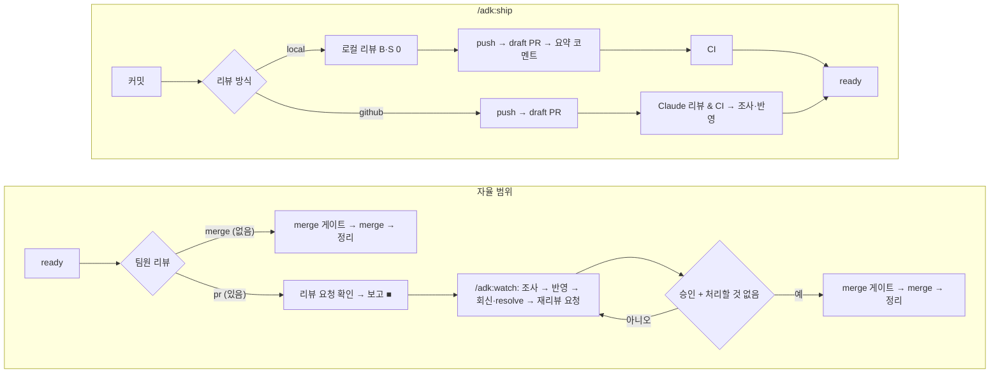

# agentic-dev-kit — 리뷰 흐름 (review flow)

## 1. 개요

- 문서 정보: 작성 2026-11-14 / 기준 커밋 `df5a528` (origin/main) / 이슈 GH#25, GH#61, GH#70, GH#75
- 기능: 자율 범위·리뷰 방식마다 PR 의 리뷰·ready·merge 흐름을 정하고, pr 모드의 팀원 리뷰 대응을 감시 스킬로 처리한다
- 목적 (Why)
  - 사람 리뷰 저장소에서 ready 가 merge 직전 → 팀원이 리뷰하는 내내 PR 이 draft("작업 중")로 보인다.
  - draft 를 유지하는 이유가 템플릿·스킬에 없다.
  - pr 모드는 리뷰 대응마다 소유자 지시가 필요하다 → 팀원 리뷰를 감시·처리하는 수단이 없다.
  - `local` 리뷰는 사전 리뷰(ship 1-1)와 PR 뒤 리뷰가 같은 head 를 두 번 리뷰할 수 있다.

## 2. 목표 및 범위

- In Scope
  - 템플릿 `CLAUDE.md` 자율 범위·리뷰 절, `/adk:ship`·`/adk:init` 절차, README 명령 표
  - 새 스킬 `/adk:watch`
- Out of Scope
  - merge 게이트(`merge-gate.sh`) 판정 조건 → 그대로 둔다
  - `claude-review.yml` 의 리뷰 기준·트리거 → 그대로 둔다
  - 적용 저장소의 갱신 → 각 저장소 세션이 `/adk:init --update` 로 한다

## 3. 요구사항

- `US#1` [요구사항] 저장소 소유자로서, 팀원 리뷰가 있는 저장소에서 리뷰 대응을 매번 지시하지 않도록, agent 가 PR 을 감시해 반영·회신·merge 까지 처리하기를 원한다. → FR#4, FR#6, FR#7
- `US#2` [요구사항] 저장소 소유자로서, Claude GitHub App 을 쓸 수 없는 저장소에서도 같은 흐름을 쓰도록, 리뷰 방식만 바꿔 리뷰를 로컬에서 받기를 원한다. → FR#2, FR#3
- `US#3` [요구사항] 팀원으로서, 리뷰할 PR 을 알아보도록, 리뷰·CI 를 통과한 PR 만 ready 로 보기를 원한다. → FR#3
- `FR#1` [요구사항] 자율 범위의 정의는 팀원 리뷰 유무다.
  - `pr`: 팀원 리뷰가 있는 저장소. merge 조건에 현재 head 의 팀원 승인이 들어간다.
  - `merge`: 팀원 리뷰가 없는 저장소. agent 가 리뷰를 확인하고 직접 merge 한다.
  - `/adk:init` 은 자율 범위를 "팀원 리뷰가 있는가" 로 묻는다.
- `FR#2` [요구사항] 리뷰 방식(`{{REVIEWER}}`)마다 PR 전 단계가 다르다. 방식은 `/adk:init` 과 `/adk:init --update` 에서 고른다.
  - `github`: 로컬 리뷰를 하지 않는다 → push → draft PR → `claude-review.yml` 리뷰 & CI → 조사·반영
  - `local`: push 전에 대화 이력 없는 subagent 리뷰를 받고 Blocking·Should Fix 0건이 된 뒤 push → draft PR → 같은 head 의 요약을 PR 코멘트로 → CI
    - 막는 장치 변경 여부와 관계없이 매번 받는다.
    - head 가 바뀌는 반영(amend·새 커밋)마다 push 전에 다시 받는다.
  - 두 방식 모두 merge 게이트가 보는 "현재 head 의 리뷰 요약" 이 PR 에 남는다.
- `FR#3` [요구사항] PR 은 draft 로 만들고, 리뷰·CI 를 통과하면 ready 로 바꾼다.
  - 통과 = CI 통과 + 현재 head 요약 존재 + ship 3-4 판정 merge 가능(미해결 Blocking·Should Fix 0건)
  - 템플릿에 draft 의 뜻을 적는다: 팀원에게 보일 준비가 안 된 상태(리뷰 또는 CI 미통과)
  - ready 뒤 head 가 바뀌어도 draft 로 되돌리지 않는다.
- `FR#4` [요구사항] pr 모드의 `/adk:ship` 은 ready 까지 묻지 않고 진행한 뒤 보고하고 멈춘다.
  - ready 전 리뷰(Claude 리뷰·로컬 리뷰)의 지적은 ship 3 의 조사로 사실인 것을 묻지 않고 반영한다. 반영은 기존 커밋 amend + `push --force-with-lease`.
  - 반영이 PRD·스펙 변경을 부르는 지적은 반영하지 않고 확인받는다 (FR#6 과 같은 기준).
  - 미루는 항목은 ship 3-1 대로 이슈로 등록한다 → 후보 보고에서 그치지 않는다.
  - ready 직후 `reviewRequests` 를 조회해 보고에 넣는다 → agent 는 리뷰어를 고르지 않는다.
    - 비어 있으면 30초 간격으로 3번까지 다시 조회한다(기다림은 `Monitor`·백그라운드 명령, foreground `sleep` 은 막힌다) → CODEOWNERS 의 자동 리뷰 요청이 ready 뒤 늦게 붙는 저장소가 있다 [요구사항: 적용 저장소 보고, ready 직후 조회 0명 → 몇 초 뒤 요청이 붙음. 재현 조건은 확인하지 못함]
      - adk 관측에서는 지연이 재현되지 않았다 [as-built: 개인 public 저장소·CODEOWNERS 한 명, bot 이 연 draft PR 을 ready 로 바꾸자 같은 초에 `review_requested`] → 재조회는 요청이 이미 있으면 돌지 않으므로 그대로 둔다
      - private 저장소에서는 CODEOWNERS 가 있어도 요청이 붙지 않을 수 있다 [as-built: private 시험 저장소에서 136초 동안 요청·`review_requested` 이벤트 없음, CODEOWNERS 오류 0건. GitHub 문서상 private 저장소의 code owners 는 유료 플랜 기능] → 그래서 CODEOWNERS 유무를 함께 보고한다
    - 그래도 비면 "리뷰 요청 없음" 과 base 브랜치의 CODEOWNERS 유무(`CODEOWNERS`·`.github/CODEOWNERS`·`docs/CODEOWNERS`)를 함께 보고한다 → 파일이 있는데 비었으면 소유자가 경로 규칙을 확인할 신호다
      - 조회가 404 가 아닌 오류로 실패하면 그 경로는 "확인하지 못함" 으로 보고한다 → 모르는 것을 "없음" 으로 보고하지 않는다
  - ready 이후 리뷰 대응·merge 는 `/adk:watch` 실행을 소유자 지시로 보고 그 스킬이 한다.
- `FR#5` [요구사항] merge 모드의 `/adk:ship` 은 ready 뒤 merge 게이트를 거쳐 squash merge 하고 정리한다.
  - 반영은 새 커밋이다.
  - ship 3-5 의 사람 리뷰 조회가 해당이면 merge 하지 않고 보고한다 → 팀원 리뷰 저장소인데 자율 범위가 `merge` 로 잡힌 경우다.
- `FR#6` [요구사항] `/adk:watch <PR 번호>` 는 pr 모드 PR 을 감시하며 한 라운드씩 처리한다.
  - 자율 범위가 `pr` 이 아니면 실행하지 않고 알린다.
  - 감시: 새 리뷰·리뷰 코멘트·일반 코멘트, `reviewRequests` 변화, CI 결과를 주기 조회하고 변화가 있으면 한 라운드를 처리한다.
  - 시작: 감시를 걸면 변화를 기다리기 전에 첫 라운드를 처리한다 → 감시 전에 달린 리뷰가 첫 조회 결과에 묻혀 "변화 없음" 이 되지 않게 한다.
    - 기준 시각은 세션 gh 계정이 남긴 마지막 "리뷰 대응" 코멘트(ship 3-2)의 작성 시각, 없으면 PR 생성 시각이다 → 기록 파일 없이 세션·기기가 바뀌어도 같은 기준을 얻는다
      - "리뷰 대응" 코멘트는 첫 줄로 찾고 제목 표지(`##`)·HEAD 표기 형식은 가리지 않는다 [as-built: 이전 PR 의 대응 코멘트 첫 줄이 `## 리뷰 대응`, `## 리뷰 대응 (HEAD 24f37bb)` 로 3-2 형식과 다름]
    - 대상: 기준 시각 뒤의 리뷰(`pulls/<번호>/reviews`)·inline 코멘트(`pulls/<번호>/comments`)·일반 코멘트(`issues/<번호>/comments`)와 미해결 리뷰 스레드. 작성자를 가리지 않고 `--paginate` 로 모두 읽는다 → 30건 넘는 PR 에서 뒤 페이지를 놓치지 않는다
    - 대상이 없으면 보고하지 않고 감시로 간다.
  - 라운드가 끝나면 감시로 돌아가기 전에 그 라운드의 수집 시각 뒤 항목을 같은 명령으로 다시 수집하고, 있으면 다음 라운드를 바로 처리한다 → 라운드 중에 달린 코멘트는 "리뷰 대응" 코멘트보다 앞이라 다음 기준 시각에 묻힌다
    - 수집 시각은 라운드 수집 직전에 `date -u +%Y-%m-%dT%H:%M:%SZ` 로 찍는다 → jq 는 문자열로 비교하므로 GitHub 시각과 같은 UTC `Z` 형식이어야 하고, 수집 뒤에 찍으면 그 사이 코멘트가 빠진다
    - 그 라운드에서 세션이 만든 코멘트·리뷰(답글, "리뷰 대응", 답글이 만든 `COMMENTED` 리뷰)의 id 는 뺀다 → 빼지 않으면 자기 글이 매번 대상이 된다. 계정으로 거르지 않는다 → agent 가 소유자 계정으로 쓰면 소유자의 글까지 빠진다
    - 남는 범위: "리뷰 대응" 코멘트를 남긴 뒤 재수집 전에 세션이 끝나면, 그 라운드 중에 달린 리뷰 본문·일반 코멘트는 다음 세션의 대상에서 빠진다. inline 지적은 미해결 스레드로 다시 잡힌다.
  - 라운드: 조사(ship 3) → 반영(amend + `push --force-with-lease`, `local` 이면 push 전 로컬 재리뷰) → 회신·resolve(FR#7) → "리뷰 대응" 코멘트(ship 3-2) → 지적한 리뷰어마다 재리뷰 요청(ship 3-5)
  - 반영 판단은 조사로 사실인 지적을 권장안대로 처리한다. 후속 건은 ship 3-1 대로 이슈로 등록한다 → 스킬 실행이 권장안 위임이다.
  - 멈추고 보고: 반영이 PRD·스펙 변경을 부르는 지적, 스펙에 없는 결정, 먼저 묻는 예외, ship 3-4 중단 판정, CI 같은 원인 2회 실패
  - merge: 처리할 지적 없음 + ship 3-5 의 승인 조건(현재 head 승인, 대기 중 재리뷰 요청 없음) + CI 통과 + 현재 head 요약 → merge 게이트 → squash merge → ship 5 정리
- `FR#7` [요구사항] 사람 리뷰 스레드는 agent 가 회신한 뒤 resolve 한다.
  - 회신 내용(반영 커밋 SHA / 미반영 근거 / 이슈 번호)은 ship 3-5 그대로다.
  - 템플릿 자율 범위 절은 사용자 전역 규칙이 resolve 주체를 달리 정해도 이 표를 따른다고 적는다 → 특정 전역 규칙 문구는 인용하지 않는다.
- `FR#8` [요구사항] README 명령 표는 `plugins/adk/skills/` 의 스킬마다 한 행을 둔다.
- `FR#9` [요구사항] 템플릿 `.claude/settings.json` allow 에 `gh pr ready`·`gh pr merge --squash`·`git worktree remove` 를 자율 범위와 관계없이 둔다 → 두 값 모두 ready·merge 를 묻지 않고 한다.
  - `gh pr merge` 는 그대로 merge 게이트 hook 을 거친다.
- `FR#10` [요구사항] `/adk:ship` 4-b 의 merge 는 `--delete-branch` 를 붙이지 않고, 5 에서 main 클론 기준으로 워크트리 → 로컬 브랜치 → 남아 있는 원격 브랜치 순으로 지운다 [as-built: 워크트리가 있는 브랜치의 `gh pr merge --delete-branch` 는 merge 뒤 `cannot delete branch … used by worktree` 로 실패]
- `FR#11` [요구사항] 리뷰 job 이 따르는 지시(템플릿·adk `claude-review.yml` prompt, `/adk:ship` review.md)의 `gh pr view` 는 `--json <필드>` 로 읽을 필드를 정한다 → job 의 `permissions` 안에서 동작한다 [as-built: 리뷰 job 에서 `gh pr view --comments` 가 check 상태 조회 중 `Resource not accessible by integration` 으로 실패]
  - 이전 라운드 읽기: `gh pr view <번호> --json body,comments`
  - 대조군 `--comments` 의 권한 오류는 실행 시점에 따라 재현되지 않을 수 있다 [as-built: 시험 저장소 run 4건 중 같은 head 의 다른 check run 이 진행 중이던 3건은 권한 오류, 모두 끝나 있던 1건은 성공. 상관관계이고 GitHub 의 조건은 확인하지 못함] → 판정은 엄격하게 두고, `runtime` 이 `pr_comments=ok` 로 실패하면 job 을 다시 실행해 본다. 다시 실행해도 `ok` 면 권한이 넓어졌는지 조사한다
    - 성공을 통과로 완화하지 않는다 → 리뷰 job 권한이 넓어져 생긴 성공과 구분할 수 없다
  - job `permissions` 는 넓히지 않는다 → `checks: read` 를 더하면 모든 형태가 동작하지만, PR 내용을 읽는 리뷰 job 의 권한을 지시 형태 때문에 넓히지 않는다
- `FR#12` [요구사항] 템플릿·adk 의 `claude-review.yml` 은 `claude_args` 에 `--permission-mode default`, `claude.yml` 은 `--permission-mode acceptEdits` 를 둔다 → `--allowedTools` 밖 호출은 거부된다 [as-built: `claude-code-action` v1.0.273 부터 opt-out 조건이 없으면 세션이 auto mode 로 시작하고, 허용 규칙이 없는 호출을 안전성 검토가 판정한다]
  - action 이 넣는 인자 뒤에 `claude_args` 가 붙는다 → 마지막 `--permission-mode` 가 이긴다
  - `claude.yml` 의 쓰기 도구는 `--disallowedTools` 로 따로 막는다 → acceptEdits 여도 편집하지 않는다
  - `claude.yml` 세션의 권한 모드는 `default` 로 관측된다 [as-built: v1.0.275 tag mode, 시험 저장소 run] → 확인은 auto mode 가 아닌지와 거부 여부로 한다
  - 런타임 관문의 격리 확인 워크플로는 템플릿의 권한 모드를 그대로 쓰고, 허용 목록 밖 명령 하나가 거부되는지와 세션 권한 모드를 본다
    - 거부는 실행 결과의 권한 거부 목록(`permission_denials`)으로 판정한다 → 거부 문구는 action 설정에 따라 달라진다 [as-built: v1.0.275 리뷰 job 의 거부 문구는 `This command requires approval`]
    - 권한 모드는 세션 시작 메시지의 `permissionMode` 로 본다
    - 권한 모드만 뺀 리뷰 변형을 대조군으로 두고 판정 줄을 기록만 한다 → 런타임 관문 환경이 auto mode 로 들어가는지 배포마다 남긴다
    - 런타임 관문 환경(OAuth 토큰)은 플래그 없이도 auto mode 로 시작하지 않는다 [as-built: v1.0.275, 대조군 `CLAUDE_ARGS` 에 auto 없음, `outside=denied`] → 이 환경의 거부는 권한 모드 플래그와 무관하다
    - 확인하지 못한 범위: auto mode 로 시작하는 환경에서 플래그가 거부를 되돌리는지는 관측하지 않았다. 근거는 action 의 인자 처리(마지막 `--permission-mode` 가 이김)와 v1.0.273 release notes 의 opt-out 안내다
  - `claude.yml` 도 같은 방식으로 본다: 렌더한 `claude.yml` 을 트리거 문구만 바꿔 복제하고, 시험 PR 코멘트로 불러 허용 목록 밖의 작업 트리 수정 Bash(`sed -i`)와 스크립트가 거부되는지 본다
- `NFR#1` [요구사항] FR#1~FR#10 의 흐름 변경은 merge 게이트(`merge-gate.sh`)와 그 테스트·mutation 목록을 바꾸지 않는다 → 흐름 변경이 보안 경계를 바꾸지 않는다.
- `NFR#2` [요구사항] 스킬 본문은 `tests/skill-size.test.sh` 상한 안에 둔다. 넘으면 특정 상황 절차를 같은 폴더 참조 파일로 옮긴다.

## 6. 동작 로직 및 정책

### 흐름

### 설계 결정

- 리뷰 방식과 자율 범위는 독립 축이다 [요구사항] → Claude App 사용 가능 여부와 팀원 유무는 따로 정해진다.
- `local` 요약은 세션 gh 계정이 쓰므로 agent 가 스스로 요약을 쓸 수 있다 [요구사항] → 소유자가 문제로 보지 않기로 했다(2026-11-14). merge 게이트는 그대로 작성자만 거른다.
- 팀원 승인은 merge 게이트가 아니라 `/adk:watch` 가 확인한다 [요구사항] → 게이트를 바꾸지 않는다(NFR#1). 브랜치 보호가 승인을 요구하면 GitHub 이 최종 경계다.
- `github` 방식은 막는 장치 변경에도 로컬 사전 리뷰를 하지 않는다 [요구사항] → Claude 리뷰만으로 확인한다.

## 7. 테스트 및 검증 기준

| TC | 대상 | Then | 비고 |
| --- | --- | --- | --- |
| TC#16 | FR#8 | `plugins/adk/skills/*/` 마다 README 명령 표에 `/adk:<이름>` 행이 있고, 없는 스킬의 행은 없음 | `tests/readme-commands.test.sh` |
| TC#17 | NFR#2 | 모든 `SKILL.md` 가 상한 이하, 참조 링크 대상 존재 | `tests/skill-size.test.sh` |
| TC#18 | NFR#1 | `merge-gate.sh`·`tests/merge-gate.test.sh`·`tests/mutations.tsv` 가 diff 에 없음, 기존 테스트 통과 | (수동) PR diff 확인 |
| TC#19 | FR#1 FR#2 FR#3 FR#4 FR#5 FR#7 FR#9 | 템플릿 `CLAUDE.md`·ship·init·README 가 같은 흐름을 적음: 자율 범위 정의, 방식별 PR 전 단계, ready 시점·draft 의 뜻, pr 의 멈춤 지점, merge 의 사람 리뷰 해당 시 보고, resolve 대체, allow 의 ready·merge 항목 | (수동) 세 곳 대조 |
| TC#20 | FR#6 | PR 에서 `/adk:watch` 한 라운드: 리뷰 코멘트 → amend·push → 스레드 회신·resolve → 리뷰 대응 코멘트 → 재리뷰 요청이 관측되고, 승인 뒤 merge 게이트를 거쳐 merge | (수동) 시험 저장소에서 `github-actions[bot]` 이 연 PR 에 소유자 계정이 리뷰어로 관측. `Monitor` 로 깨어나는 감시 루프는 관측 대상 아님 |
| TC#21 | FR#6 | `merge` 모드 저장소에서 `/adk:watch` 를 실행하면 감시하지 않고 알림 | (수동) |
| TC#43 | FR#10 | 4-b merge 명령에 `--delete-branch` 없음. 워크트리에서 시작한 브랜치에 `cleanup.md` 명령을 줄마다 실행 → 원격 브랜치가 남은 저장소·자동 삭제 저장소 모두 줄마다 종료 코드 0, 워크트리·로컬·원격 브랜치 없음, `main` 갱신 | `tests/cleanup.test.sh` (임시 bare 원격·워크트리) |
| TC#75 | FR#11 | 템플릿·adk `claude-review.yml` prompt 와 review.md 의 `gh pr view` 마다 `--json` 이 있음 | `tests/review-prompt.test.sh` |
| TC#76 | FR#11 | 렌더한 리뷰 job 과 같은 권한·격리에서 prompt 의 이전 라운드 명령이 성공하고, 대조군의 `gh pr view <번호> --comments` 는 권한 오류로 실패 | `tests/runtime.sh` (version 올림 PR 의 CI `runtime` job), 배포 관문 스펙 FR#5 |
| TC#80 | FR#12 | 템플릿·adk 의 `claude-review.yml` `claude_args` 에 `--permission-mode default`, `claude.yml` 에 `--permission-mode acceptEdits` 가 있고 다른 `--permission-mode` 는 없음 | `tests/review-prompt.test.sh` |
| TC#81 | FR#12 | 격리 확인 워크플로가 템플릿의 `--permission-mode` 를 그대로 두고 허용 목록 밖 명령(`sh probe/outside.sh`)을 시도하게 함. 판정: 실행 출력 표지가 있으면 ran, 권한 거부 목록에 그 호출이 있으면 denied(문구와 무관), 그 밖 오류는 error-other. 세션 시작 메시지의 `permissionMode` 를 mode 로 냄 | `tests/probe.test.sh` |
| TC#82 | FR#12 | 렌더한 리뷰 job 과 같은 권한·격리에서 허용 목록 밖 명령이 denied 이고 mode 가 default | `tests/runtime.sh` (version 올림 PR 의 CI `runtime` job), 배포 관문 스펙 FR#5 |
| TC#85 | FR#12 | 권한 모드 대조군 워크플로가 scrub 변형에서 `--permission-mode` 줄만 빠짐 | `tests/probe.test.sh` |
| TC#86 | FR#12 | 같은 runtime 실행에서 대조군 판정 줄이 `info` 로 기록됨 (실패시키지 않음) | (수동) `runtime` job 로그 확인. 대조군이 `outside=ran`·`mode=auto` 를 내면 위 확인하지 못한 범위를 다시 본다 |
| TC#83 | FR#12 | `@claude` 확인 워크플로가 렌더한 `claude.yml` 과 트리거 문구·판정 step·action step id 만 다름. 판정 줄에 작업 트리 수정 Bash(`edit=`) 결과가 있음 | `tests/probe.test.sh` |
| TC#84 | FR#12 | 시험 PR 코멘트로 부른 `@claude` 확인 워크플로에서 `edit=denied outside=denied`, mode 는 `default` 또는 `acceptEdits`(auto 아님). 진행 코멘트가 깨운 건너뛴 run 은 고르지 않음 | `tests/runtime.sh` (version 올림 PR 의 CI `runtime` job) |
| TC#22 | FR#2 | `local` 렌더 결과에 `claude-review.yml`·`claude.yml` 없음, `github` 렌더 결과에 있음 | (수동) `/adk:init` 렌더 확인 |
| TC#87 | FR#4 | ready 직후 `reviewRequests` 가 비면 30초 간격 3번까지 다시 조회하고, 그래도 비면 보고에 "리뷰 요청 없음" 과 CODEOWNERS 유무가 함께 있음. CODEOWNERS 로 늦게 붙은 리뷰어는 보고에 들어감 | (수동) CODEOWNERS 를 둔 저장소에서 bot 이 연 draft PR 을 ready 로 바꾸고 4-a 의 조회 명령을 실행. PR 작성자가 CODEOWNERS 와 같은 계정이면 요청이 붙지 않는다 |
| TC#88 | FR#6 | `/adk:watch` 의 첫 라운드 수집 명령이 reviews·pulls/comments·issues/comments 셋 모두 `--paginate` 로 읽고 기준 시각 뒤로 거르며, 기준 시각은 `--paginate` 로 읽은 일반 코멘트 중 "리뷰 대응" 코멘트의 작성 시각에서 정함. 라운드 뒤 재수집의 수집 시각을 `date -u +%Y-%m-%dT%H:%M:%SZ` 로 찍음 | `tests/watch.test.sh` |
| TC#89 | FR#6 | 리뷰가 이미 달린 PR 에 새 세션에서 `/adk:watch` 를 걸면 변화를 기다리지 않고 그 리뷰를 첫 라운드에서 처리하고, 마지막 "리뷰 대응" 이전 코멘트는 다시 처리하지 않음. 라운드 중에 다른 계정이 단 코멘트는 그 라운드 뒤 재수집으로 처리되고, 세션 자신의 답글·"리뷰 대응" 만 있으면 재수집 대상은 0건 | (수동) 시험 저장소 PR |
- GH-61: 리뷰 job 지시의 `gh pr view` 를 `--json` 필드 지정으로
- GH-70: 리뷰·`@claude` job 의 권한 모드를 명시해 허용 목록을 엄격하게
- GH-75: ready 직후 리뷰 요청 재조회, 감시 시작 시 첫 라운드 처리
